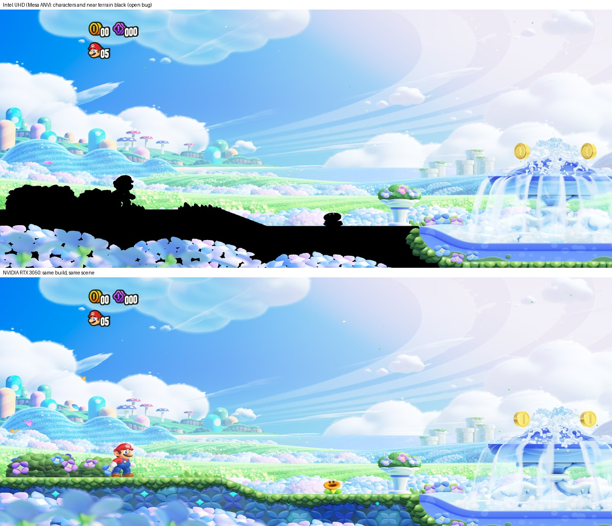

# Ultrawide, frame rate and integrated GPUs (2026-10-17)

Three studies run on the Linux port, then merged and measured together. The detailed write-ups:

| Study | Document | Result |
|---|---|---|
| Ultrawide (21:9, 32:9) | [ultrawide-1710.md](ultrawide-1710.md) | **works** behind `NX_ULTRAWIDE=1`: real Hor+ (more of the level, not stretched) |
| Frame rate above 60 | [fps-unlock-1710.md](fps-unlock-1710.md) | **not by a switch**: the game steps once per frame; `NX_FPS_CAP=30` is the clean low-end mode |
| Integrated Intel GPU | [intel-igpu-1710.md](intel-igpu-1710.md), then [intel-60fps-1710.md](intel-60fps-1710.md) | **60 fps at 720p with a correct picture** (black silhouettes fixed; performance power profile; pipelined submits) |

Every number below comes from unattended runs (`NX_HEADLESS=1`: frames are rendered and dumped, nothing is
presented, so they measure frame production, not a display), on one machine: Ubuntu 26.04, Intel Core (Alder Lake,
12 threads, 14 GB), **Intel UHD Graphics (ADL-S GT0.5, Mesa ANV)** and **NVIDIA RTX 3050 6 GB Laptop GPU (driver
595)**. The same scripted input in each run (L+R at the title, A through the menus and dialogs) reaches the Flower
Kingdom intro; "game" is the median of the last 12 windows of 60 frames there.

## Measurements

| Configuration | Intel title | Intel game | RTX title | RTX game |
|---|---|---|---|---|
| `dev` before the studies, docked 1080p | 49.1 | 26.4 | 51.5 | 29.5 |
| this branch, defaults (docked 1080p) | 60.0 | **31.3** | 51.9 | 30.5 |
| handheld 720p, `NX_PIPELINED=2` | 60.0 | **41.4** | 60.0 | **53.2** |
| preset `intel`: 720p, pipelined, `NX_FPS_CAP=30` | 30.0 | **30.0 flat** | 30.0 | **30.0 flat** |
| `NX_ULTRAWIDE=1` at 2560x1080, docked | 49.2 | 30.8 | 51.2 | 29.8 |
| `NX_ULTRAWIDE=1` at 2560x1080, 720p, pipelined | 60.0 | 35.4 | 60.0 | 52.8 |

- No crash in any of the 12 runs. Peak resident memory 1.9-2.1 GB (Intel), 2.4-2.5 GB (RTX).
- The Intel picture is **wrong** in gameplay (see below): its game numbers were taken with characters and near
  terrain drawn black, so they may change once that is fixed.
- Docked, both GPUs sit near 30: the game's own governor falls to its 30 fps mode when a frame takes more than
  15.83 ms, and the CPU replay of the frame takes about 17.5 ms on this machine (intel-igpu-1710.md). Handheld halves
  the pixels and the RTX then holds 53 fps.
- The game's 30/60 switching shows as averages between the two (35-50 at 720p on the Intel); `NX_FPS_CAP=30` gives
  a flat 30 at the right game speed.

Raw logs, frame dumps and the summary: `private/estudos/runs/final/` (local, not in the repository).

## How to use it

| Switch | Effect |
|---|---|
| `NX_ULTRAWIDE=1` | wider view to the window's shape (`=2560x1080` or `=21:9` to force one); HUD and menus stay a centred 16:9 area; restart after resizing |
| `NX_FPS_CAP=30` | the game's own 30 fps mode, always: steady frames, less CPU (1.77 to 1.47 cores in the course) |
| `NX_PIPELINED=0` | synchronous submits; the new default pipelines on integrated GPUs (phones included) |
| `NX_PAD_BUFFERS=1` | the old zero padding after bound buffers (dropped where the GPU bound-checks; 10.3 to 4.8 MB uploaded per frame) |
| `NX_DISPLAY_HZ=<hz>` | experimental: vsync at another rate; the game then runs faster or slower, not smoother |

`tools/wonder_linux.sh` presets: `quality` (docked 1080p), `balanced` / `performance` (720p + FSR), `intel` (integrated
GPU, 720p, pipelined, 30 fps) and `lightest` (`intel` + FSR).

The Android launcher has the same choices: Image > Widescreen, Performance > Screen rate (experimental), GPU submits
in flight (Automatic by default), Advanced > Buffer padding.

## Above 60 fps

The game advances its simulation by the present interval it asked for (one or two sixtieths per frame), not by
measured time (`sead::GameFramework::procFrame_`, fps-unlock-1710.md). A faster vsync makes the whole game run faster
and the music fall out of step. The ways to a real 120 are a fractional simulation step (days of reverse engineering,
risky for physics) or frame generation in the present pass (weeks, needs optical flow on the GPU). Neither is done.

## Black silhouettes on Intel: fixed the same day

**Update (later on 2026-10-17):** fixed and the Intel reaches 60 fps at 720p, see [intel-60fps-1710.md](intel-60fps-1710.md).
The cause was not an `Fma` but vertex-shader outputs the game leaves unwritten on some paths (Maxwell reads zero,
Mesa ANV garbage); they now start at zero (`NX_ZERO_VS_OUTPUTS`). The analysis below is what led there.

On the Intel UHD (Mesa ANV) the characters and the near terrain are drawn black in gameplay; the same build on the
RTX is right. The cause is narrowed (intel-igpu-1710.md, "Black silhouettes"):

- the lit "uber" fragment shaders read **NaN** texels from a 192x108 RGBA16F low-resolution lighting buffer, a blur
  of a 384x216 buffer that already holds NaN;
- turning NaN into 0 after every image sample brings Peach, the bushes and the flower back in colour (not the flat
  ground), which proves the mechanism;
- the NaN is born in an `Fma` of three character-lighting fragment shaders (`465e881ccb17cc7d`, `9a959f14e6a1dc0e`,
  `f708ec2ce5a7ff55`): sanitising after `Fma` there leaves no NaN downstream;
- ruled out: invariant position, float controls, subgroup size, depth-equal slack, HiZ/aux, ASTC path, NaN from
  divisions, square roots and exp/log.

Inferred, not verified: a multiply of zero by infinity that Maxwell turns into 0 and ANV keeps as NaN, in an `Fma`
the translator's FMZ patch (`tools/maxwell/spirv_harness/translator/spirv-fmz.patch`) does not cover. Next step
(about half a day): bisect the `Fma` indices of those three modules (`tools/intel/nansan.py` with `NANSAN=Fma`
and a narrowing `NANRANGE=<lo>-<hi>`) and emulate the Maxwell rule on that instruction in the SPIR-V patch pass.

## Ultrawide: what is left

HUD and menus are a centred 16:9 area, not anchored to the edges; full-screen menu backdrops leave side bands (the
title and character-select pictures in the README show them); the aspect is fixed at start; the cameras are found by
a heap scan every 2 s (about 11% of a core). Tested on the title, menus, the Flower Kingdom intro and the opening at
the castle; not on the world map, course 1-1 proper, wipes, bosses, auto-scroll or multiplayer. Next steps and
estimates: ultrawide-1710.md.

## Not verified

- Any of this with a window on screen (all runs headless), FSR cost, the Android APK on a phone.
- The Intel numbers with a correct picture.
- `NX_PIPELINED` and the unpadded buffers on Adreno/Mali (DEBUG-2 #76 exploded meshes, DEBUG.md #21) and on macOS.
